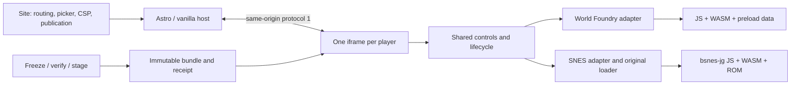
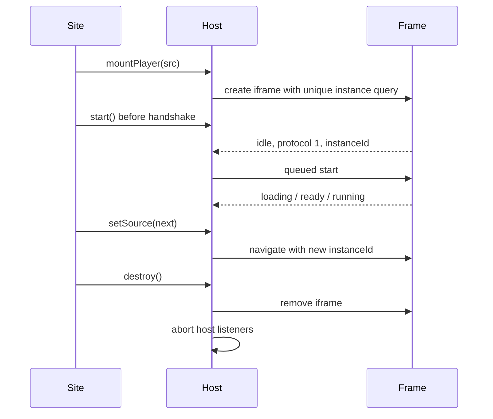

# Integrating and maintaining Browser Game Player

The component is a static browser shell around existing World Foundry and bsnes-jg runtimes. It provides an Astro component, vanilla DOM API, configuration validation and immutable asset tooling. It does not compile engines, allocate their memory, render their scenes or replace the emulator.

## Architecture and ownership



The distributable package includes these guides and text-only example configs/build tool. The combined runnable ZIP, raw ROM and source archives are separate release assets.

The site owns URL/history, game selection, release selection and fallback content. The host owns the frame and message listeners. The shell owns focused input, fullscreen/menu/retry/restart presentation and pause policy. Adapters translate lifecycle operations into existing runtime calls. Disposal removes the iframe; there is no claim of an in-process engine teardown API.

## Installation and build environment

Install the versioned GitHub release tarball shown in the repository README, or vendor it and use `file:vendor/<tarball>`. Releases are not published to the npm registry. Pin the tarball in your lockfile. Astro is an optional peer (`>=5 <7`); vanilla integration needs no Astro installation.

Use the pinned `.node-version` for development and CI. Consumers require Node >=22.12.0. Native SDKs are needed only if you rebuild a native runtime, not to change the player or stage existing assets. Serve frames over HTTP(S) from the parent origin.

## Prepare a verified frame

Start from [`examples/baseline.json`](../examples/baseline.json) for World Foundry or [`examples/doom-fire.json`](../examples/doom-fire.json) for SNES. These are the actual downloadable example profiles; the larger FYW/gallery/SNES consumer configs remain separate. Wrap it in build options:

```json
{
  "runtimeDirectory": "vendor/my-runtime",
  "output": "build/player",
  "config": { "schema": 1 },
  "provenance": { "sourceCommit": "replace-with-your-actual-pin" }
}
```

The abbreviated `config` above is not sufficient to run: use a complete example and edit its game fields. Paths resolve from the command's working directory. `poster` in build options names a local source image; config `poster` must be `title-preview.jpg` or null.

```sh
browser-game-player freeze options.json
browser-game-player check build/player/bgp1-<hash>
browser-game-player sync build/player/bgp1-<hash> public/games/demo/bundles
browser-game-player sync build/player/bgp1-<hash> public/games/demo/bundles --check
```

Write `public/games/demo/manifest.json` with `{"bundleId":"bgp1-<hash>"}` to select the staged bundle. Sync verifies source/destination byte identities, stages atomically and never prunes. Keep selected and deployed bundles until your site's retention policy permits deletion.

```astro
---
import GamePlayer from '@wbniv/browser-game-player/astro';
import { verifyManifest } from '@wbniv/browser-game-player/bundle';
const { frame } = verifyManifest('public/games/demo', '/games/demo');
---
<GamePlayer src={frame} title="Demo" />
```

`verifyManifest` runs during the site build. It validates the selected directory and returns `{receipt, frame}`. Production routing must serve `frame.html` and every sibling asset; a site catch-all page must not intercept these requests.

## Astro props

| Prop | Default / behavior |
|---|---|
| `src` | Required verified frame URL unless `deferred` is true. |
| `title` | Required accessible iframe title. |
| `id`, `class` | Host div identifier/classes. |
| `frameClass` | Class placed on iframe. |
| `autoHeight` | true; accepts bounded frame height updates. |
| `deferred` | false; emits a host without starting a frame. |
| `srcBase` | Stored as `data-src-base` for site-owned gallery code; not an automatic picker. |

The component attaches on initial load and `astro:page-load`, disposes before `astro:before-swap`, and disposes on non-persisted `pagehide`. A deferred gallery must resolve its own selection, set `data-src` and mount/connect the host. Preserve Astro's `history.state` when updating filter URLs; replacing it with null breaks ClientRouter Back handling. Dispose page-owned listeners on swaps.

## Vanilla API

```js
import { mountPlayer } from '@wbniv/browser-game-player';
const host = document.querySelector('#game');
const player = mountPlayer(host, {src: verifiedFrameUrl, title: 'Demo'});
host.addEventListener('player-state', ({detail}) => console.log(detail.state));
// On site navigation:
player.destroy();
```

| Member / option | Contract |
|---|---|
| `frame`, `instanceId`, `state` | Frame element and current identity/state. Initial state is idle; destroyed state is disposed. |
| `start()`, `pause()`, `resume()` | Queue commands until the idle handshake. Resume does not grant browser user activation. |
| `restart()` | Parent confirmation; sends confirmed restart only if accepted. |
| `setSource(url)` | Same-origin frame navigation; rotates identity and clears pending commands when source changes. |
| `destroy()` | Idempotent; aborts listeners, removes frame and clears queued commands. Other commands after destruction throw. |
| `src`, `title` | Frame URL and accessible name. Cross-origin frames throw. |
| `className`, `loading` | Iframe class and loading attribute (default eager). |
| `autoHeight` | true unless explicitly false. |
| `restartPrompt` | Parent confirmation text; frame-menu confirmation uses config text. |

`connectPlayers(root=document)` discovers `[data-browser-game-player]`, reads `data-src`, `data-title`, `data-frame-class`, `data-auto-height`, stores each handle as `host.player`, and skips existing handles. Call it only for hosts with resolved URLs. Independent players have separate windows, identities and input ownership. `start()` via postMessage cannot substitute for a direct fullscreen/audio gesture.

## Configuration reference (schema 1)

| Fields | Requirements |
|---|---|
| `adapter`, `startMode` | `worldfoundry` / `snes`; `manual` / `auto`. |
| `title`, `subtitle`, `status`, `canvasLabel` | Nonempty display/accessibility strings. Title is limited to 200 characters. |
| `restartPrompt`, `fallbackLabel`, `fallbackUrl` | Nonempty text and HTTP(S) or relative fallback link. |
| `poster`, `fullscreenOnPlay` | null / `title-preview.jpg`; required boolean. |
| `arguments` | Array of native argument strings; each shorter than 4096 characters. |
| `help` | One to twenty nonempty paragraphs. |
| `actions` | One to twelve `{code,label,caption}` controls. Caption is at most 30 characters. |
| `motionCode` | Optional supported key code; only use if the game implements reduced motion. |
| WF `levels`, `defaultLevel` | Optional slug-to-`{title,arguments}` table and declared default. Overrides cannot alter adapter/shell settings. |
| SNES `game`, `games` | Required selected ROM ID and allowlist containing it. |
| SNES `previews` | Optional subset of allowed ROM IDs with corresponding PNGs. |
| SNES `verifyLabels` | Optional allowed-ID-to-label table, e.g. `"lzss-gallery":"Verify benchmark"`. |
| SNES `keyboardHint` | Optional loader hint; standard pad mapping remains unchanged. |

The validator accepts arrows, KeyA–KeyZ, Space, Digit0–9, supported Numpad codes, Enter and left/right Shift. It validates documented fields but is not a general JSON-schema engine or a security policy for arbitrary untrusted runtime arguments. Treat configs and binaries as trusted build inputs. WF `?level=<slug>` and SNES `?game=<id>` are allowlisted; invalid selections fall back to defaults. Arbitrary legacy `?rom=` overrides are disabled by the adapter.

## Assets and provenance

| Adapter | Required runtime files |
|---|---|
| World Foundry | `wf_game.js`, `wf_game.wasm`, `wf_game.data` from a compatible build. |
| SNES | `cores/bsnes_jg.js`, `cores/bsnes_jg.wasm`, `cores/PROVENANCE.json`, `roms/manifest.json`, one `.sfc` per declared ID; configured preview PNGs. |

Freeze adds the shell, both adapter scripts, config, rendered frame and receipt. Unselected ROM bytes are not copied, but the supplied ROM manifest is copied verbatim: trim its entries yourself for a small distributable example. SNES `selfcheck` expectations belong to the original ROM manifest; never invent or rewrite them to make a check pass.

Receipts contain schema, protocol, component version, a `bgp1-` content identity, per-file bytes/SHA-256, total bytes and caller-supplied provenance. Identity incorporates component version/protocol and file inventory; provenance is checked for immutable relabeling but is not included in that content hash. Hashes detect drift; receipts are not signatures. Verification requires the current package's exact component version and rendered frame template, rejects missing/extra/symlink files, and checks the SNES allowlist against manifest entries. Do not use a new package to verify an older receipt: retain its matching package or regenerate a new bundle.

## Messages and lifecycle



Messages use `{type:'browser-game-player', protocol:1, instanceId, command}` or `event`. The host checks sender window, exact origin, protocol and instance ID. Frame events are idle/loading/ready/running/paused/error or height; detail is an optional string up to 4000 characters. Height must be finite and between 200 and 2400 pixels. `player-state` contains `{state,instanceId,detail}`. These are observations, not a strict application-state machine: native callbacks can report ready before running. Frame navigation rejects stale identities.

The shell clears held keys/pointers on cancellation, focus loss, pause and teardown. Hidden-document events pause; resume requires focus/interaction. Fullscreen loss, WebGL context restoration, OS occlusion and mobile background behavior are not all proven across platforms. No persistence or save-state API is promised.

WF wraps existing Module startup/main-loop methods. SNES retains bsnes-jg 2.1.0 binaries and its loader's pad mapping, WRAM checks and ROM hit rectangles. The narrow hook layer delegates fullscreen/input lifecycle to the shell. Pointer coordinates account for the displayed image's letterboxing; black margins remain inert.

## Serving, CSP and caching

Serve `.wasm` as `application/wasm`, JS as JavaScript and JSON as JSON. Allow same-origin scripts/assets, WebAssembly compilation in script policy (`'wasm-unsafe-eval'` where supported), and the site's own player frame paths in `frame-src`. Frame responses must allow their actual embedding site in `frame-ancestors` and must not carry contradictory X-Frame-Options. Avoid granting external origins or arbitrary site pages framing permission merely to embed a player.

Astro ClientRouter requires its generated script activation to work under the site's nonce/hash policy. The local consumer test uses a nonce/CSP server shim; deployment must separately check the real edge headers. Cache versioned bundle files immutably; make the small selection manifest revalidate. This release does not require SharedArrayBuffer, COOP/COEP, service workers or cross-origin frames.

## Development and release checks

Run `npm test`, `npm run check` and `npm pack`. Install that tarball in consumers; build and run the built pages, not only development routes. `tests/README.md` documents optional real-browser checks using existing Playwright/browser installations. The release witnesses include real runtimes in Ubuntu 24.10, two-frame protocol/disposal checks, accepted FYW input, SNES fidelity, ROM touch navigation and three consumer builds.

Use `examples/build-release.py --help` to reproduce the combined downloadable examples from existing pinned inputs. It copies the emulator and ROM, trims manifest entries, and repacks one WF preload without recompiling or changing its WASM. It records source hashes and writes ZIPs with deterministic timestamps. Companion source archives and licenses are separate release assets so players download only the runnable files.

Chromium/Firefox and emulated phone checks establish bounded functional coverage. They do not establish all-ROM fidelity, physical-phone/Apple compatibility or sustained performance. See the versioned verification reports for exact evidence.
