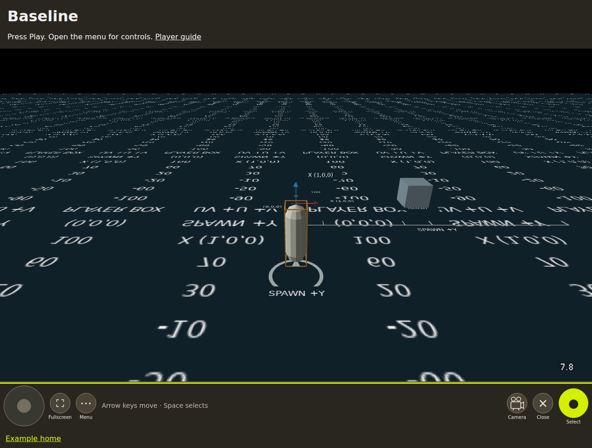
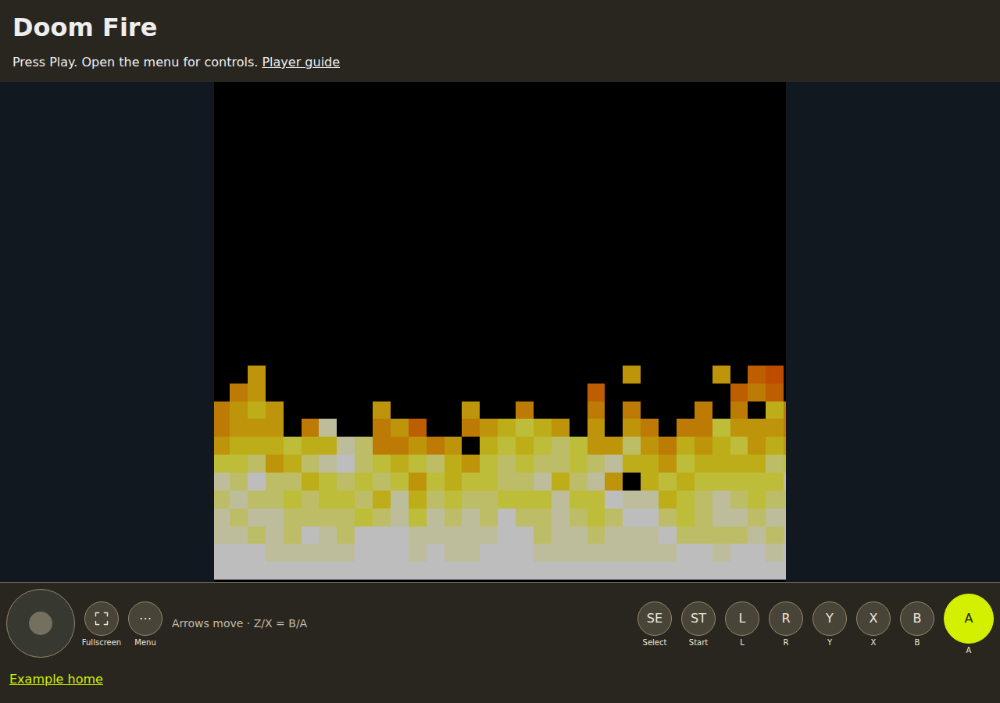
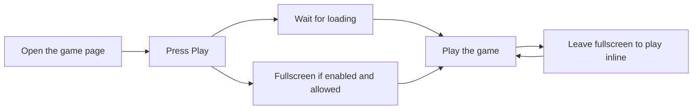
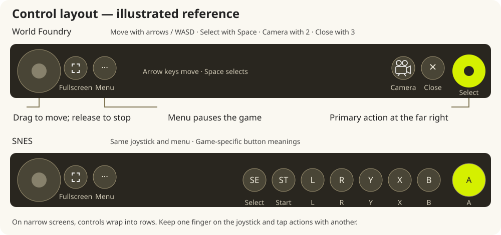
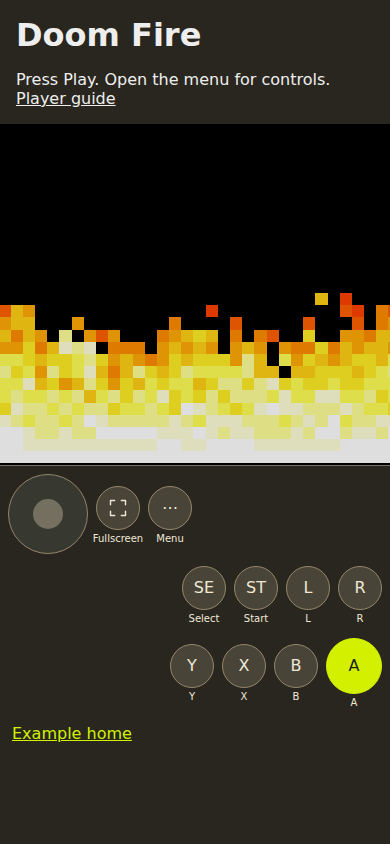
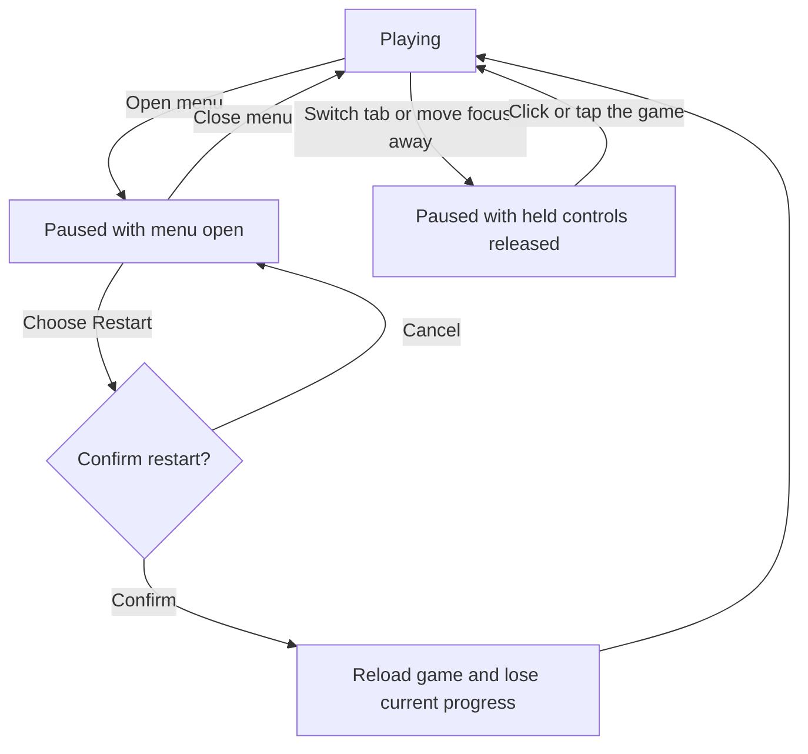

# Playing a game

Browser Game Player supplies the game screen, controls, loading messages and menu. The game decides what its buttons do. World Foundry games and SNES ROMs use the same player, with controls appropriate to each game.

## See the player



**World Foundry Baseline:** the game fills the main area; movement, fullscreen and menu sit on the left, with camera, close dialogue and Select on the right.



**SNES Doom Fire:** the flames shown here are the running demo, after its title screen. The game keeps its original screen proportions, with SNES buttons underneath.

## Start and fullscreen

Press **Play**. A title screen can appear before the game downloads. Some pages start automatically; those normally stay inline until you choose fullscreen from the menu. Manual Play requests fullscreen only when the page has enabled it. If the browser declines, you can still play inline.

Click or tap the game to give it keyboard focus. The first interaction also enables browser audio where the runtime supports audio. On a phone, landscape orientation usually gives the game more room. Black margins around a SNES screen preserve its shape; they are not touch controls.



## Controls

The joystick is a plain circle with a movable center. Drag the circular joystick to move; release it to stop. You can hold an action with another finger. The labels beside the joystick are the selected game's actions. Keyboard input belongs to the focused game; release a held key before switching to another player.



*Illustrated control reference. The layout wraps on narrow screens; actual game action labels can vary.*

| World Foundry default | Keyboard |
|---|---|
| Move/turn | Arrow keys, I/J/K/L or W/A/S/D |
| Select/interact | Space |
| Camera | 2 |
| Close dialogue | 3 |

These are common defaults, not a promise that every level assigns the same actions. Read that game's menu help. Dialogue controls and optional reduced motion are game-specific. The film-camera button changes the in-game camera; it does not record video.

| SNES control | Keyboard |
|---|---|
| D-pad | Arrow keys |
| B / A | Z / X |
| Y / X | A / S |
| L / R | Q / W |
| Start / Select | Enter / Shift |

The SNES screen provides the corresponding circular buttons, including **ST** for Start and **SE** for Select. Some ROMs also draw their own clickable navigation arrows. SNES gamepad support is not implemented by this adapter.

### On a phone



The joystick stays on the left. The action buttons wrap so they remain easy to tap. This is a phone-sized browser view; landscape gives the game more room. Use the compact fullscreen button to expand the player.

## Menu, pause and restart

Open the menu for control help, fullscreen, restart and any game-specific actions. Opening it pauses gameplay. Closing it returns focus to the game and resumes. Moving focus away or hiding the page releases held input and pauses; click or tap the game to continue. Escape closes the menu first, then leaves fullscreen or releases game focus.

**Restart** asks for confirmation and reloads the game. Current progress is lost. The component does not provide saved games or save states. Leaving the page or choosing another game removes the old runtime frame.



**Verify fidelity**, when present on a SNES game, runs the ROM's published self-check against the emulator's memory. Ordinary checks restart the emulated machine and can interrupt play. A pass confirms that particular check, not every possible interaction. A benchmark ROM may label its action **Verify benchmark** instead.

## Downloadable examples

The [release page](https://github.com/wbniv/browser-game-player/releases) supplies one **`browser-game-player-examples-0.1.4.zip`** download (published with v0.1.4; later component-only releases leave it unchanged). Its starting page offers both examples:

- **SNES Doom Fire:** one 32 KiB homebrew ROM, emulator and player; its fidelity check runs 500 frames and expects `0x3C59`. The ROM is bundled with the runtime so you can try the player directly.
- **World Foundry Baseline:** one standalone level, engine and player. The engine is reused; its preload contains only this level.

Unzip the combined download, open a terminal in the extracted directory, and run:

```sh
python3 -m http.server 8000 --bind 127.0.0.1
```

Open **http://localhost:8000/**, choose **Baseline** or **Doom Fire**, and press Play. Use **All examples** to return to the starting page. Stop the server with Ctrl+C. These are static websites, not native installers. Opening `index.html` directly with a `file:` URL will not reliably load WebAssembly or game files. No Node, compiler, Emscripten SDK or internet access is required to play the extracted example.

## If something goes wrong

| Symptom | Try |
|---|---|
| Loading error | Check your connection or local server, then press Retry and Play again. |
| Keys scroll the page or do nothing | Click/tap the game to focus it; check its menu help. |
| Game paused after changing tabs | Click/tap the game to resume. |
| Fullscreen does not open | Use the menu's fullscreen action with a click/tap, or play inline. |
| No audio | Interact with the game and check browser/device mute; some levels have no bundled sound. |
| Verification takes time | Let the indicated check finish; native emulation speed varies by browser/device. |

If reporting a bug, include the page URL, browser/device, game, the action that caused it and the loading message. A screenshot helps with layout problems. The player has been tested in Chromium and Firefox with phone-sized touch viewports; these checks are not physical-phone or Apple certification.
